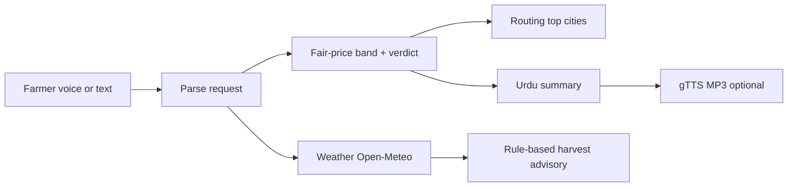

# Sahi Daam AI

Voice-first fair-price, harvest-or-hold, and city re-routing advisor for Punjab mandi sales (AICON'26).

Farmers describe a crop, quantity, district, and broker quote (voice or typed Urdu/English). The app parses the request, compares the quote to **WHOLESALE** AMIS mandi bands (not farm-gate prices), suggests safer wording (“below wholesale range”), optional harvest timing from **rule-based** weather + trend signals, and top alternate cities by **estimated** net margin after assumed transport and commission.

**DEPLOYED_URL:** _(fill after Streamlit Cloud / hosting deploy)_

### Next.js UI (`web/`)

Urdu-first RTL frontend (Next.js + Tailwind) with MOCK data aligned to `schema.py` / AMIS markets. No network by default.

```powershell
cd web
copy .env.example .env.local
npm install
npm run dev
```

See [`web/README.md`](web/README.md). Streamlit (`app.py`) remains the live-engine demo.

---

## Problem

Smallholders often receive a single broker quote without a reference wholesale band, without knowing whether another mandi net of transport might pay more, and without a simple harvest-vs-hold cue when rain or heat is forecast. Sahi Daam AI bundles those checks into one Streamlit session with Urdu summary and optional text-to-speech.

---

## End-to-end flow



1. **Input** — Microphone (HTTPS/localhost), audio upload, typed text, or sample cases from `tests/voice_cases.csv`.
2. **Parse** — Gemini structured JSON extraction when the API key and model work; otherwise **offline** `rule_based_extract` in `voice_parser.py` (lexicon + numbers).
3. **Analyze** — `analysis/analyze.py`: commodity mapping, `get_band()` fair-price band, `assess_quote()` verdict, `rank_cities()` routing, `fetch_district_weather()` + `generate_harvest_advice()` advisory.
4. **Output** — Verdict panel, band caption, routing table, advisory (if band usable), Urdu summary; optional **gTTS** Urdu audio of the summary only.

---

## Where AI / ML operates (honest split)

| Component | Technique | Model / library | Notes |
| --- | --- | --- | --- |
| Voice/text **parse** (live path) | LLM structured extraction | **Google Gemini** via `google-genai`; model from `GEMINI_MODEL` → `LLM_MODEL` → `config.DEFAULT_MODEL` (`gemini-3.5-flash`) | Live eval **0/20** on typed cases when configured model returns `model_not_found` — see [Evaluation summary](#evaluation-summary). |
| Voice/text **parse** (fallback) | Rules + lexicon | `voice_parser.rule_based_extract` | **MEASURED** 20/20 on `tests/voice_cases.csv` (typed text, not speech). |
| Fair-price **band** | Quantile regression when enough history; else recent-median band | `scikit-learn` in `model/price_band.py` | Rolling backtest (MEASURED): ML median does **not** beat naive last-FQP on Onion/Tomato; demo often uses `recent_median_band`. |
| **Verdict** | Threshold rules vs band | `analysis/verdict.py` | Wording: “below wholesale range”, not fraud claims. |
| **Routing** | Net margin formula | `analysis/routing.py` | Transport/commission are **ASSUMPTIONS** in `config.py`. |
| **Price trend** | Descriptive median change | `analysis/trend.py` | See `reports/trend_metrics.md`; treat as descriptive unless it beats Flat/shuffled baselines. |
| **Harvest advisory** | **Rule-based** on Open-Meteo + trend | `advisory_engine.py` | **NOT ML.** Thresholds marked heuristic — verify with an agronomist. |
| **Urdu TTS** | Text-to-speech | **gTTS** (`lang="ur"`) | Converts **Urdu summary text** only; does not parse speech. |

**Microphone:** Browser `getUserMedia` requires **HTTPS or localhost**.

---

## Data sources and limits

| Source | Use | Timeout / cache |
| --- | --- | --- |
| [AMIS Punjab](http://www.amis.pk) wholesale tables | Daily FQP (Rs per 100 kg → Rs/maund ×0.4) | Scrape timeout 20 s; polite 1.5 s delay; cached HTML under `data/raw/` |
| **Open-Meteo** | District forecast for advisory | **5 s** timeout; SQLite `data/weather_cache.db` |
| **Gemini API** | Parse text/audio | 15 s HTTP timeout; session cap `MAX_AI_CALLS_PER_SESSION=15` |

### AMIS cache status (**MEASURED**, `reports/data_quality.md`, generated 2026-10-10)

- **434** rows in `data/amis_prices.csv`
- Date range **2026-07-13 … 2026-10-09**
- **0** duplicate keys, **0** suspect rows, **0** unit sanity failures
- Thin-pair rule for models/demo: **&lt;90 days** present per (commodity, city) — **all 35 tracked pairs still thin** (max single pair in cache: Tomato/Lahore **74** days)

Wholesale AMIS prices are **not** farm-gate prices. Do not interpolate or fabricate missing days (`scripts/collect_amis.py` for backfill).

---

## Run locally (Windows PowerShell)

```powershell
cd C:\Users\muham\Sahi_Daam_AI
python -m pip install -r requirements.txt
Copy-Item .env.example .env
# Edit .env: set GEMINI_API_KEY and a valid GEMINI_MODEL (see below)
python -m streamlit run app.py
```

Open the URL shown (typically `http://localhost:8501`). For microphone capture, use localhost or deploy with HTTPS.

### Environment variables

| Variable | Purpose |
| --- | --- |
| `GEMINI_API_KEY` or `GOOGLE_API_KEY` | Gemini API access |
| `GEMINI_MODEL` | Preferred model ID (recommended: run `python -m scripts.check_env` and set to a listed Flash model that passes TEXT+AUDIO) |
| `LLM_MODEL` | Fallback alias if `GEMINI_MODEL` unset |
| _(default)_ | `config.DEFAULT_MODEL` = **`gemini-3.5-flash`** |

`.env.example` may list `gemini-3.5-flash`. If the API returns **`model_not_found`**, set `GEMINI_MODEL` to a current Flash ID (e.g. API listings often include **`gemini-3.8-flash`** — confirm with `scripts/check_env.py`, do not assume accuracy metrics). Never commit `.env`.

---

## Tests

```powershell
python -m pytest -q
```

Covers parsing, bands, verdict wording, routing, advisory rules, UI helpers, and smoke import of `app.py`.

---

## Evaluation commands

Regenerate reports under `reports/`:

```powershell
python -m scripts.run_all_checks
```

Individual scripts:

| Script | Output |
| --- | --- |
| `python -m scripts.data_quality` | `reports/data_quality.md` |
| `python -m scripts.evaluate` | `reports/metrics.md`, `reports/metrics.json` |
| `python -m scripts.estimate_spread` | `reports/spread.md` |
| `python -m scripts.eval_trend` | `reports/trend_metrics.md` |
| `python -m scripts.eval_simulated_quotes` | `reports/simulated_quotes.md` |
| `python -m scripts.eval_llm_text` | `reports/llm_text_metrics.md` |
| `python -m scripts.eval_voice` | `reports/voice_metrics.md` (human WAVs) |
| `python -m scripts.eval_voice_synth` | `reports/voice_synth.md` (gTTS clips) |
| `python -m scripts.bench_latency` | `reports/latency.md` |
| `python -m scripts.check_weather` | stdout LIVE weather smoke |
| `python -m scripts.check_env` | Gemini key/model TEXT+AUDIO smoke |
| `python -m scripts.preflight` | Deploy checklist |

Demo CLI (offline parse):

```powershell
python -m scripts.demo_analyze "40 maund Tomato Okara quote 2800" --offline
```

---

## Evaluation summary (tagged)

| Metric | Value | Tag |
| --- | --- | --- |
| AMIS rows / date span | 434 / 2026-07-13..2026-10-09 | **MEASURED** |
| Pairs with ≥90 days history | 0 of 35 tracked | **MEASURED** |
| Sample typed analyze: `40 maund Tomato Okara quote 2800` | Verdict **Very low**; reference **Lahore**; band low/avg/high **5400 / 5800 / 6000** Rs/maund; basis `recent_median_band`; data_as_of **2026-10-09** | **MEASURED** (`scripts.demo_analyze --offline`) |
| Sample: Wheat / Lahore quote | **Unable to assess** (no usable Wheat band at Lahore; 0 days Wheat/Lahore in CSV) | **MEASURED** |
| `analyze()` latency (weather stubbed) | p50 **127.2 ms**, p95 **164.4 ms**, n=20 warm | **MEASURED** (`reports/latency.md`) |
| Live LLM parse latency bench | SKIPPED (`model_not_found`) | **MEASURED** |
| Cross-market spread (Onion) | n=89 origin-days; median gross gap **3.23%**; share net gain &gt;0 **16.9%**; median net among &gt;0 **131.7** Rs/maund | **ESTIMATE** (`reports/spread.md`) |
| Cross-market spread (Tomato) | n=89; median gross gap **4.07%**; share net &gt;0 **15.7%**; median net among &gt;0 **436.5** Rs/maund | **ESTIMATE** |
| Rolling price-band backtest | Onion **n=42** MAE naive **338** / model **391**; Tomato **n=41** MAE naive **380** / model **423** (Rs/maund). Model does **not** beat naive. Coverage model ~34–40% vs nominal 80%. | **MEASURED** (`reports/metrics.md`) |
| Trend held-out directional agree | **49.3%** (n=134) vs always-Flat **6.0%** vs shuffled **38.1%** — better than baselines on aggregate; still not a forecast product claim | **MEASURED** (`reports/trend_metrics.md`) |
| Simulated quote flag rates | See `reports/simulated_quotes.md` | **SIMULATED** |
| Offline typed parse (`voice_cases.csv` n=20) | **20/20** full row | **MEASURED** (typed text, **not** speech accuracy) |
| Live Gemini typed parse | **0/20** (`model_not_found` / errors) | **MEASURED** |
| Human voice recordings eval | **none yet** | **MEASURED** (`reports/voice_metrics.md`) |
| gTTS → Gemini audio parse | Run `eval_voice_synth.py` when key+model OK | **SYNTHETIC-AUDIO** |

We **do not** report farmer income gains or speech recognition accuracy on real farmer recordings.

---

## What we do **not** claim

- Proven increase in farmer income or net returns in the field
- Speech-to-text accuracy on real mandi audio (no human recording benchmark yet)
- That the ML band beats a naive last-price forecast (MEASURED: it does **not**, on current folds)
- Calibrated 80% band coverage (observed model coverage well below 80% on current folds)
- Farm-gate price fairness (only WHOLESALE AMIS reference)
- Agronomic certainty for harvest advice (heuristic weather rules only)
- Potato Fresh/Store coverage in all cities (many pairs empty in cache)

---

## Limitations

- AMIS history still short for most city×commodity pairs (&lt;90 days); Lahore Tomato/Onion drive most backtest rows.
- Wheat and several city/commodity pairs have **zero** or sparse days — expect **Unable to assess** often for Wheat/Lahore.
- Routing net gain uses haversine × road factor and flat Rs/maund/km — not observed truck quotes.
- Gemini model IDs retire; live voice path depends on a valid `GEMINI_MODEL`.
- gTTS requires network; Urdu pronunciation may not match local dialect.
- Public deploy: protect API keys via Streamlit secrets and session call limits.

---

## Third-party licences (summary)

| Package | Licence (typical) | Role |
| --- | --- | --- |
| Streamlit | Apache-2.0 | UI |
| google-genai | Apache-2.0 | Gemini client |
| gTTS | MIT | Urdu TTS |
| pydantic | MIT | Schemas |
| pandas / numpy / scikit-learn | BSD | Data + band model |
| requests / beautifulsoup4 / lxml | Apache / MIT | AMIS fetch/parse |
| python-dotenv | BSD | Local env |
| pytest | MIT | Tests |

See each package’s PyPI page for full licence text. AMIS data is government-published wholesale information; respect site terms when scraping.

---

## Built with AI coding assistants

Portions of this repository were drafted and refactored with **Cursor** and large language model assistants (including Claude/GPT-class models). All evaluation numbers in this README come from **`reports/`** and scripted runs on this machine, not from model estimates.

---

## Team contributions

| Member | Role | Contributions |
| --- | --- | --- |
| | | |
| | | |
| | | |

---

## Related docs

- [docs/DEMO_SCRIPT.md](docs/DEMO_SCRIPT.md) — 5-minute judge demo
- [docs/JUDGE_QA.md](docs/JUDGE_QA.md) — anticipated Q&A
- [docs/SUBMISSION_CHECKLIST.md](docs/SUBMISSION_CHECKLIST.md) — hand-in checklist
- [docs/slides_outline.md](docs/slides_outline.md) — slide deck outline
- [docs/Sahi_Daam_AI_Demo.pptx](docs/Sahi_Daam_AI_Demo.pptx) — demo slides
- [docs/PHASE6_LOG.md](docs/PHASE6_LOG.md) — Phase 6 engineering log
